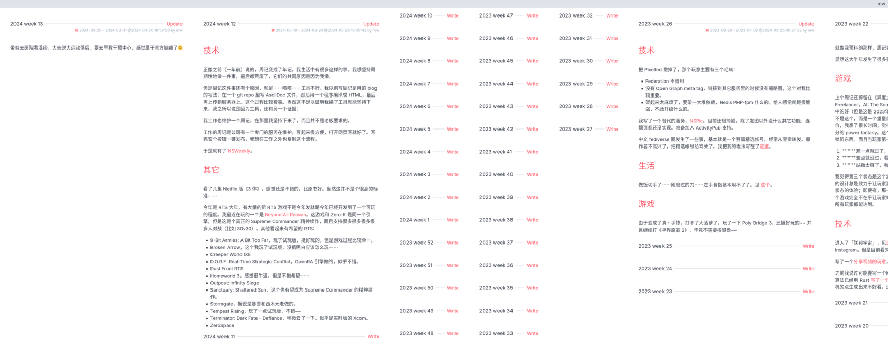

= NSWeekly

A naively simple self-hosted weekly snippet tool

== Introduction

NSWeekly is an extremely simple tool to let you (and other people)
write weekly snippets (like a journal) in MacroDown (Markdown with macros).

== Deployment

NSWeekly depends on libcurl and thread-safe SQLite 3.35.0 or newer.
MacroDown is fetched during the build.

Arch Linux users can build NSWeekly using the
link:packages/arch/PKGBUILD[PKGBUILD] in the repo; otherwise

1. Build the binary using CMake.
2. Copy the binary to somewhere in `$PATH`.
3. Copy the `statics` and `templates` directory to a suitable place
(for example `/var/lib/nsweekly`).
4. Create a configuration file at `/etc/nsweekly.yaml`, and at a
minimum set `data-dir` to the directory you put the `statics` and
`templates` in. NSWeekly will create a sqlite3 database file in this
directory.

== Configuration

See an link:packages/arch/nsweekly.yaml[example configration file].

NSWeekly allows multiple users to write weeklies in the same instance.
However, it does not have any ability to manage the user accounts. All
user management is delegated to an external OpenID Connect server. In
principle you can let it use the big public services such as Google or
GitHub, but I have only tested it on my self-hosted KeyCloak server.
There are four configuration options involved:

- `client-id`: The client ID you registered with the OpenID Connect
  service
- `client-secret`: The client secret the OpenID Connect provided for
  your registered client.
  service
- `openid-url-prefix`: This is the “root URL” of the OpenID Connect.
  Suppose you put `https://example.com` here (trailing slash will be
  removed automatically), NSWeekly will visit
  `https://example.com/.well-known/openid-configuration` to discover
  the endpoints of the OpenID Connect service.
- `url-prefix`: the expected URL prefix of your NSWeekly service. This
  is used to provide a OpenID redirection URL. If you set this to
  `https://example.com` (trailing slash will be removed
  automatically), NSWeekly will watch
  `https://example.com/openid-redirect` for incoming OpenID
  redirections. Note that right now NSWeekly does not support hosting
  at a non-root path, so this value should not contain a URL path.

NSWeekly uses `preferred_username` from the OpenID Connect user info
endpoint as the account key. If that field is absent, it uses `name`.
Changing the account key will make existing weeklies appear under the
old account.

Other notable options:

- `guest-index`: This determines what a guest (a visitor that is not
  logged in) see when visiting the service. Right now the only
  possible value is `user-weekly`, meaning the guest is redirected to
  the weekly of a user.
- `guest_index_user`: This defines the default user whose weekly are
  shown to guests, when `guest-index` is `user-weekly`.
- `default_lang`: The default IETF BCP 47 language tag (RFC 5646) of
  the weekly posts. Right now this is global.

== Development

Module source files and their unit tests live in `src/auth`, `src/weekly`,
and `src/games`. Application wiring and shared services remain in `src`.
Includes use paths relative to `src`, such as `games/game_data.hpp`.
Module templates and assets likewise live in `templates/weekly`,
`templates/games`, `statics/weekly`, and `statics/games`. Shared templates
and site icons remain at the top level. Deploy these directories recursively.

Configure tests with `cmake -S . -B build -DBUILD_TESTING=ON`, build with
`cmake --build build -j24`, and run
`ctest --test-dir build --output-on-failure`.
To build against a local libmw checkout, configure with
`-DFETCHCONTENT_SOURCE_DIR_LIBMW=/path/to/libmw`.
The route tests start a server on a temporary loopback port. Storage tests
use isolated temporary databases; they do not open the deployed database.
Run `python3 tests/smoke_test.py build/nsweekly` to exercise production startup,
login, editing, and persistence against a local OpenID stub and legacy schema.

`App` owns the authentication backend, shared sessions, user storage, and
weekly storage. `AuthModule` and `WeeklyModule` register their own routes.
`App` derives from `mw::HTTPServer` and registers routes in `setup()`.
`start()` launches the server thread; `wait()` blocks until it exits.
Call `stop()` before `wait()` when shutting down from another thread.
User and weekly SQLite implementations own separate connections to the same
file. New features should provide their own storage and HTTP module with
explicit wiring in `App`.

The module extraction preserves existing guest redirects, including the two
Location headers produced for an unknown guest user, and applies refreshed
cookies only on the root route. Two undefined accesses are corrected:
empty weekly ranges return an empty list, and an authorized edit page with
no weekly result returns HTTP 404. Regression tests cover both outcomes.
The HTML fixture under `tests/fixtures` was captured before extraction;
only its clock-dependent update timestamp is normalized for comparison.

== Game tracking

Visit `/games/` after signing in, or `/games/USERNAME` to read a public
tracker. Games links on weekly pages provide navigation. Owners can add,
edit, rename, and delete games through native forms. Notes and every other
tracking field are public. Notes and weekly posts use MacroDown.
Sorting runs in the browser; a cookie remembers the selected column and
direction for one year across tracker pages. Forms work without
JavaScript; JavaScript enhances dialogs and sorting. POSTs require an
Origin matching `url-prefix`. Platform and action icons use the official
Nerd Fonts webfont stylesheet and `<i class="nf ...">` elements; no symbols
font is bundled in statics.

Game storage creates `GameTracking`, `GamePlatforms`, and `GameReviews` alongside the
existing tables, using a separate connection. Scalar and platform saves
commit together. Missing hours and zero hours remain distinct. Names are
stripped, case-sensitive, and unique within an account.

Weekly posts and games use MacroDown HEAD. Both the native renderer and the
weekly WebAssembly preview are built from the same fetched source checkout.
libmw, uni-algo, and Unicode data notices are preserved in `licenses/`
and installed by the Arch package.

Emscripten is required. Install and activate it so `emcmake` is on `PATH`
before configuring; CMake reports an error if it is missing. Every build
includes the weekly WebAssembly preview, generating
`statics/macrodown/macrodown.mjs` and `macrodown.wasm`; deploy these alongside
all other static files. Serve `.mjs` as JavaScript and `.wasm` as
`application/wasm`. These generated files are excluded from Git.
Preview rendering failures leave
editing and saving available. The weekly editor uses the shared EasyMDE
toolbar and keeps the MacroDown preview alongside the source. Preview HTML
is displayed directly, matching the native renderer's unsanitized output.
If the EasyMDE CDN is unavailable,
the editor keeps a native textarea and the Wasm preview. Serve the repository
and open `tests/weekly_editor_browser.html` to check toolbar actions, form
synchronization, responsive layout, and MacroDown preview rendering.

For local development, pass
`-DFETCHCONTENT_SOURCE_DIR_MACRODOWN=/path/to/macrodown` as well as the
libmw override. MacroDown uses uni-algo v1.2.0. libmw supplies httplib
transitively through `mw::http-server`; the version verified here is
`edc9760005c7358adc7a6170ff0be4c2e242ee09`. libmw currently follows httplib's
upstream default branch. For reproducible release builds, check out that
httplib revision and pass `-DFETCHCONTENT_SOURCE_DIR_HTTPLIB=/path/to/httplib`.
Local dependency overrides intentionally take precedence over pins; verify
the checkout revisions when preparing a release. Do not add a separate
httplib target or link to the application.

=== Temporary Tracker migration

Stop the service and back up the closed database, or use SQLite's backup
API. Export only the Tracker sheet as UTF-8 CSV. Run:

[source,sh]
----
nsweekly --config /etc/nsweekly.yaml \
    --import-games-csv /tmp/tracker.csv --import-games-user mw
----

The target account must already exist. Import runs without OpenID discovery,
templates, or an HTTP listener. All rows are validated before inserting any
games. Invalid rows exit 2; configuration failures exit 3; storage failures
exit 4. Successful imports exit 0 and report input, blank, inserted, and
both duplicate counts. `Game` (or `Name`) and `Status` headers are required;
optional headers may be omitted or reordered. Platforms from both columns
are combined. Review and extra columns are ignored and reported.

The importer never overwrites existing games. Repeating an import skips
existing names. If storage fails partway through, the report identifies the
record and committed insert count; correct the failure and rerun. Dates
must use `YYYY-MM-DD`; hours must be nonnegative 32-bit integers. Notes
retain internal whitespace and MacroDown source.

For read-only preflight, run the import on a copy of the stopped database
in a temporary data directory, using a configuration pointing there. Compare
its report with the CSV before running against the deployment. Restart and
inspect totals, platforms, notes, dates, zero hours, and missing hours. Keep
the original export and backup until verified. An older binary can ignore
the games tables; do not delete them on rollback. Remove the temporary import
flags in a separate change after the operator verifies the migration and
one repeat run.

The Tracker fixture contains observed blank/end-only/two-platform patterns;
its `Synthetic zero` record adds synthetic zero-hour and multiline cases.
Run the smoke test for production games CRUD and CLI import, and use
`tests/games_browser.html` for repeatable browser sorting and dialog checks.

== Game reviews

Game names in both tables link to `/games/USERNAME/ID`, a public detail
page containing all tracker fields, full rendered notes and review text,
scores, and review dates. Owners also get edit and delete links.

Open Reviews within Games, or visit `/games/USERNAME/reviews`. To write a
review, hover or focus a game's name cell in the tracker and use its review
icon. Creation and editing open a separate page with the rubric beside
the form (below it on mobile). Each tracked game has at most one review,
editable by its owner and
readable publicly. Review names link back to the tracked game.

Story/Lore, Gameplay, Graphics, Audio, and Special accept scores from 1 to
10, including fractions; 5 means average. Each game has one optional
overall MacroDown review; individual dimensions have no comments.
Blank scores keep a review incomplete. The browser computes overall as
`(story + 2 * gameplay + graphics + audio + special) / 6`, displays one
decimal place, and sorts using the unrounded value. Overall is never
stored. Without JavaScript the inputs and review remain readable, and
native forms still work, but overall and sorting require JavaScript.

Reviews default to overall descending and preserve sorting for one year in
a separate `nsweekly-reviews-sort` cookie. Hours comes from the tracker.
Creation/update times are stored as integer UTC Unix timestamps and shown
as UTC `yyyy-mm-dd`. Deleting a review leaves the game; deleting a game
also deletes its review. Tracker CSV import continues to ignore the Review
column. Import the Reviews sheet separately with the command below.

See `designs/design-2-reviews.md` for the schema, routes, formula, and checks.

When Node.js is available, CTest also runs the review formula checks. They
can be run directly with `node tests/reviews_score_test.js`.

=== Reviews spreadsheet migration

Export the Reviews tab as CSV. Import the Tracker first, then run:

[source,sh]
----
nsweekly -c /path/to/nsweekly.yaml \
    --import-reviews-csv /tmp/reviews.csv --import-reviews-user mw
----

The account must already exist. Game names match its tracker exactly after
stripping outer whitespace; unknown names fail validation before any review
is inserted. Required headers are `Game`, `Story/Lore`, `Game Play`,
`Graphics`, `Audio`, and `Special`. `Name` and `Gameplay` are accepted aliases.
Columns may be reordered. `Review` text is ignored; imported reviews
start with empty prose. Blank dimension cells remain blank; migration does not apply the
editor's default scores of five.

Optional `Addition` and `Update` dates use `yyyy-mm-dd` and become UTC
midnight Unix timestamp integers. A missing Update uses Addition; when both
are absent, both use the migration time. Update without Addition, invalid
calendar dates, or an update preceding addition fail validation.

Calculated `Overall`, `Hours`, and `Text export` columns, unnamed spacer
columns, and other unrecognized columns are ignored and reported. CSV does
not carry spreadsheet cell comments. Overall remains browser-calculated,
and hours still comes from the tracker.

All rows are validated before writes. The first duplicate game in the file
wins; an existing database review is never overwritten, including if another
process creates it during migration. A summary reports blank rows, inserts,
and both kinds of duplicates. A storage failure reports how many inserts
committed; rerun safely to resume. Exit codes match tracker migration: 0 for
success, 2 for input errors, 3 for configuration errors, and 4 for storage
errors. Tracker and review imports cannot be combined in one invocation.

== Link previews

Weekly, tracker, and reviews pages include server-rendered Open Graph
metadata: title, website type, canonical URL, description, site name, and
the existing PNG icon with its dimensions and alt text. Absolute page and
image URLs use `url-prefix`, so configure it to the public address. Query
parameters and fragments are omitted from canonical metadata URLs. Editor
and confirmation pages identify the corresponding public page; metadata
never contains unsaved form text or browser-calculated overall scores.

== Shared public attachments

The Attachments navigation link opens the logged-in account's manager.
Upload and deletion work without JavaScript. Every file is public; ownership
only limits listing and deletion. Duplicate uploads with the same exact
basename return the owner's existing record and upload date. Different names
or owners have separate records sharing one immutable file.

Configuration keys (all optional):

* `attachment-dir`: defaults to `<data-dir>/attachments`.
* `attachment-upload-limit`: maximum file bytes; absent means no application
  cap, and zero permits only empty files. Proxy/HTTP transport limits apply
  independently; configure those to match the intended deployment.
* `attachment-image-pixels`: maximum decoded source pixels, default 64000000
  (allowed 1–1000000000).
* `attachment-image-dimension`: maximum requested width/height, default 16384
  (allowed 1–65536).
* `attachment-image-concurrency`: simultaneous conversions, default 2
  (allowed 1–64).

System dependencies include libmagic and Magick++ through pkg-config, and
libmw crypto at revision `2d9bcbd` or newer. ImageMagick is initialized once
with 256 MiB memory, 512 MiB mapped cache, 1 GiB disk cache and two library
threads. The system ImageMagick policy can impose stricter limits. Conversion
supports single-frame JPEG, PNG and WebP only. Unsupported or oversized
images remain valid original attachments. Upload never converts automatically.

Consumers borrow `AttachmentService`. Call `beginUpload(user_id, filename)`,
append binary chunks to the move-only writer, then call `finish()`. Use
`listAttachments`, `getAttachment` and `deleteAttachment` for owner records.
Call `ensureImageVariant(user_id, record_id, {1280, 720, 80, "webp"})` for a
cached image fitting that bounding box, without enlargement. Its returned URL
serves persisted bytes directly. Errors use `E<>`; conversion errors leave
the original intact. No public transformation endpoint is exposed.

Deploy the binary and recursive templates/statics together. Give the
application write access to the attachment directory and Apache read/traverse
access. Published files live at `<root>/<first-two-hex>/<32-hex-hash>`; staging
is never public. Use `examples/apache_attachments.conf` before the catch-all
proxy mapping. It sets passive raster MIME types from a narrow URL suffix
allowlist and makes everything else an octet-stream download with nosniff.
The application fallback probes MIME and sends encoded RFC 6266 filenames,
including UTF-8 `filename*`. Apache derives the download name from the URL;
verify exact saved names in Firefox and Chromium for your deployment,
including Unicode, spaces, percent signs and quotes. The example intentionally
has no unverified encoding-aware filename header rule.

Check upload, guest GET/HEAD download and a consumer-requested image variant
before rollout. Apache should still serve published files while the backend
is stopped, support ranges/validators, and deny staging/index access. Public
responses cache for one hour. Deletion may break embedded links, other owners
can retain shared bytes, and downloaded/cached copies can survive deletion.
Purge a CDN separately when earlier cache removal is needed.

Back up SQLite and the attachment directory in one coordinated snapshot or
with the application stopped. Startup clears abandoned staging, retries queued
cleanup, removes published orphans and reports missing/corrupt known files
without deleting owner records. Only one process should mutate a shared root;
multiple process coordination is outside the attachment service's scope.

Run `python3 tests/smoke_test.py build/nsweekly` for isolated production
coverage, including attachment streaming, authorization, filenames, binary
GET/HEAD, ranges, size rejection and deletion. Run
`python3 tests/apache_attachments_test.py` on an Apache installation to test
the shipped direct-serving policy with the application stopped; exit 77
means Apache is unavailable. Browser save-name checks remain a deployment
check in Firefox and Chromium.
