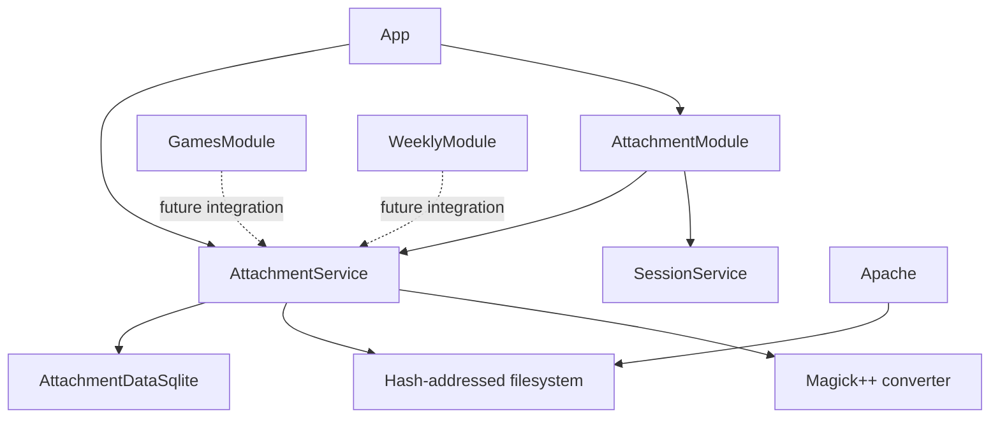

# Shared attachments

Status: proposed design, 2026-10-10.

## Purpose and agreed behavior

Provide a shared attachment service for every feature module, plus an
owner-only management interface. Users can upload arbitrary file contents,
list their attachments, copy public URLs, and delete their own attachment
records. The service also produces reusable compressed image variants at
parameters selected by the consuming module.

All attachment contents are public. Ownership controls management, not
reading. A hash is a content identifier, not an authorization token.
Uploading the same contents repeatedly is successful, not a conflict.

Store each unique file on the filesystem, never as a database BLOB. Its
filename is its SHA-256-half identifier, without an extension. Use the
first two hexadecimal characters as a directory prefix:

```text
<attachment-dir>/a3/a3f81c0123456789abcdef0123456789
```

The public URL remains:

```text
/attachment/a3f81c0123456789abcdef0123456789/original%20name.pdf
```

The final URL component is cosmetic. It need not match a database record.
The hash alone selects the bytes. Generated links use the original filename
saved for that user's attachment record. Multiple users, or one user with
multiple filenames, can have separate records referring to the same file.

In deployment, Apache serves public files directly from disk. The
application supplies an equivalent GET/HEAD implementation for development
and installations without a file-serving proxy. Neither path requires login
or a database lookup to authorize a download.

This change supplies the service and management UI. It does not add upload
widgets to weekly/game editors, rewrite existing Markdown, track arbitrary
Markdown references, or introduce private attachments. Those are separate
integrations that can call the shared service later.

## Composition and directory layout

`App` owns one `AttachmentService` and one `AttachmentModule`. The service
owns attachment storage, filesystem publication, image conversion, and
coordination between these operations. The HTTP module borrows the service,
`SessionService`, user storage, and immutable configuration. Other modules
borrow `AttachmentService` when they need it; they do not call the attachment
HTTP endpoints internally or manipulate attachment tables/files directly.



Use the established module directories:

| Path | Responsibility |
| --- | --- |
| `src/attachment/attachment.hpp` | File, record, result, and error types |
| `src/attachment/attachment_data.hpp/.cpp` | SQLite schema and queries |
| `src/attachment/attachment_service.hpp/.cpp` | Upload, deletion, URLs, coordination |
| `src/attachment/attachment_files.hpp/.cpp` | Staging, hashing, publication, cleanup |
| `src/attachment/image_variant.hpp/.cpp` | Parameter validation and Magick++ adapter |
| `src/attachment/attachment_module.hpp/.cpp` | HTTP dispatch and management rendering |
| `src/attachment/*_test.cpp` | Tests beside the implementation |
| `templates/attachment/attachments.html` | Upload and list page |
| `templates/attachment/delete.html` | Native deletion confirmation |
| `statics/attachment/attachments.css` | Module styling |
| `examples/apache_attachments.conf` | File mapping and response policy example |

Keep shared navigation, metadata, configuration, and application composition
in their existing locations. Add Attachments to the shared module navigation,
linking to the logged-in account's manager, or `/attachments/` for guests.
Use the existing header and Open Graph helpers for management pages without
putting attachment names or private owner lists into social metadata.

## Identity and filename rules

SHA-256-half means the first 16 bytes of the SHA-256 digest of the exact
uploaded bytes, encoded as 32 lowercase hexadecimal characters. Do not hash
the filename, owner, MIME type, or multipart framing. Empty files are valid.
Treat this 128-bit value as the complete content identity throughout the
system. Do not calculate or store a separate full SHA-256 digest or perform
collision disambiguation. Matching half hashes identify the same stored file;
reuse the existing bytes rather than overwriting them.

All code paths use one helper to derive `<root>/<hash[0:2]>/<hash>`. It accepts
only canonical 32-character lowercase hex identifiers. Filenames supplied
by users never participate in filesystem paths.

Save the multipart filename as UTF-8 without Unicode normalization or
whitespace trimming. Preserve spaces, accents, and emoji. Strip any client
path prefix using both `/` and `\` separators, as browser uploads may contain
path-like names. Reject invalid UTF-8, NUL, control characters, an empty
basename, and basenames `.` or `..`. A proposed metadata limit is 1024 UTF-8
bytes; report an explicit validation error rather than silently truncating.
These checks constrain metadata, not the file contents or extension.

Construct public URLs by percent-encoding the entire basename as one URL
segment. Encode `%`, `?`, `#`, and quotes, not just spaces. Display names
through HTML escaping. Management forms use numeric record IDs, not hashes,
because ownership and filenames belong to records.

The same user uploading identical bytes under the same exact basename gets
the existing record and its original upload date. The same bytes with a
different basename create another record. Another user's upload always
creates or returns that other user's own record. A duplicate notice describes
only the current user's record; it does not enumerate other owners.

## Database model

Create attachment tables in the existing SQLite database after Users.
Use foreign keys on every connection and a dedicated attachment connection,
consistent with the existing module storage implementations. All timestamps
are INTEGER UTC Unix seconds; the UI displays UTC `yyyy-mm-dd`.

### AttachmentFiles

One row describes one stored byte sequence, including generated variants:

| Column | Type / constraints | Meaning |
| --- | --- | --- |
| `hash` | TEXT primary key | Canonical SHA-256-half identifier |
| `byte_size` | INTEGER NOT NULL, >= 0 | Exact byte count |
| `mime_type` | TEXT NOT NULL | Content-probed MIME type |
| `created` | INTEGER NOT NULL | First publication time |

Validate hash lengths and lowercase hexadecimal characters in C++ and SQL.
Do not put an owner or filename here: those are not properties of file bytes.
Copy and adapt `probeMimeType` from
`/home/mw/programs/nsblog/src/attachment.cpp` into the attachment module.
It uses libmagic (`magic_open(MAGIC_MIME_TYPE)`, `magic_load`, and
`magic_buffer`) and falls back to `application/octet-stream` on failure.
Store the probed type as a property of the file, shared by all owners.
Content-type headers sent by an uploader are hints, not the authoritative
stored type, and are never used to establish identity.

Adapt the helper to probe the completed staging file with `magic_descriptor`
instead of buffering the whole upload for `magic_buffer`. Use a separate
read descriptor so probing cannot disturb the upload writer. Preserve the
fallback behavior and copy the returned type string before closing the
libmagic handle. Use RAII to close the handle on every path: the source
helper's `magic_load` and `magic_buffer` failure paths currently omit
`magic_close`, which must be corrected in the copied implementation.

### Attachments

One row describes a user's named attachment:

| Column | Type / constraints | Meaning |
| --- | --- | --- |
| `id` | INTEGER PRIMARY KEY AUTOINCREMENT | Stable management identity |
| `user_id` | INTEGER NOT NULL REFERENCES Users(id) | Owner |
| `file_hash` | TEXT NOT NULL REFERENCES AttachmentFiles(hash) | Original bytes |
| `original_name` | TEXT COLLATE BINARY NOT NULL | Validated original basename |
| `added` | INTEGER NOT NULL | Record creation time |

Enforce `UNIQUE(user_id, file_hash, original_name)` and index `file_hash` for
reference queries. Names are case-sensitive. A user can own multiple files
with the same name when their contents differ. Uploading an existing record
returns its ID without changing its date. Do not use replacement inserts
that delete and recreate records.

### AttachmentVariants

One row maps an original to a generated result:

| Column | Type / constraints | Meaning |
| --- | --- | --- |
| `source_hash` | TEXT NOT NULL REFERENCES AttachmentFiles(hash) | Original bytes |
| `recipe` | TEXT NOT NULL | Canonical transformation key |
| `output_hash` | TEXT NOT NULL REFERENCES AttachmentFiles(hash) | Generated bytes |
| `width`, `height` | INTEGER NOT NULL, > 0 | Actual output dimensions |
| `format` | TEXT NOT NULL | Canonical output format |
| `created` | INTEGER NOT NULL | Generation time |

Primary key: `(source_hash, recipe)`. Index `output_hash`. Different recipes
may produce the same output hash; physical storage still deduplicates them.
A generated file may also be uploaded as an ordinary attachment later.
Do not assume originals and variants occupy separate hash namespaces.

### AttachmentCleanup

`hash TEXT PRIMARY KEY REFERENCES AttachmentFiles(hash)` records pending
physical reclamation. Enqueue hashes transactionally when references are
removed. Its existence does not override reference checks. A new upload or
variant publication cancels a pending cleanup entry before adopting a file.

Use `ON DELETE RESTRICT` for file references. The service removes variant
mappings explicitly before file metadata, making reclamation order visible.
User deletion is not added by this feature; a future user-deletion service
must remove attachments through this service rather than bypass cleanup.

## Shared C++ interface

Expose intentions through public comments and return `mw::E<>`-style errors,
using the project's `E<>` alias. Magick++ exceptions are caught at the adapter
boundary and translated into errors. Do not expose Magick++ types to callers.

The service provides these operations:

| Operation | Contract |
| --- | --- |
| `beginUpload(user, filename)` | Validates identity/name; creates a staging writer |
| `writer.append(bytes)` | Writes a chunk and updates the digest and byte count |
| `writer.finish()` | Publishes bytes and creates/returns the owner's record |
| `listAttachments(user)` | Returns only that owner's records and file sizes |
| `getAttachment(user, id)` | Returns an owner-filtered record or missing |
| `deleteAttachment(user, id)` | Removes that owner's record and schedules cleanup |
| `ensureImageVariant(user, id, options)` | Returns a cached/generated variant for an owned attachment |
| `attachmentURL(hash, filename)` | Constructs the public URL with encoded basename |

The upload writer is move-only and deletes its unpublished temporary file
on destruction. `finish()` returns the record, public URL, and a boolean
`already_owned`. It does not report another user's duplicate as a special
condition. Storage callers validate owner existence and input just like
HTTP callers; HTTP authentication itself stays in `AttachmentModule`.

The variant result contains output hash, format, dimensions, byte size, and
public URL. Derive its cosmetic name from the source stem plus the actual
output extension, for example `photo.webp`. The output URL remains usable
without requesting a transformation again.

Consumer modules supply a bounded, explicit `ImageVariantOptions` value.
They do not expose an arbitrary public resize endpoint. A failed image
conversion never invalidates the original attachment or its public URL.

## Filesystem publication and upload algorithm

Default the configurable `attachment-dir` to `<data-dir>/attachments`.
Create `.staging` inside that directory.
Only the application writes; Apache needs read access to published shards.
Do not mount the entire directory under a public static prefix: that would
expose staging files.

1. Authenticate and validate the owner and multipart structure before
   accepting file data. Use httplib's streaming content reader.
2. Create a unique temporary file in `.staging` with exclusive creation.
   Staging must be on the same filesystem as the final shards.
3. Stream chunks into it while computing a SHA-256-half digest and counting
   bytes. An empty file still completes the normal digest operation.
4. On disconnect, parse error, write error, or configured upload-size
   rejection, close and remove the temporary file; create no record.
5. Flush and close the completed file, derive the half hash, and acquire
   the service mutation mutex.
6. Check existing metadata and any existing final file. A matching half hash
   reuses the existing file and its saved byte size. If metadata exists but
   the file is missing, report a storage error. Rehash an orphan final file
   with SHA-256-half before adopting it; a mismatch with its path indicates
   corruption, not a second content identity.
7. Create the two-character shard if necessary. Publish with an atomic
   no-replace operation, such as `link` followed by unlinking the staging
   name on the same filesystem. A competing existing name is inspected and
   reused, never overwritten by a plain replacing rename.
8. In a SQLite transaction, insert/verify file metadata, cancel cleanup for
   that hash, and insert or return the user's attachment record. Commit.
9. Release the mutex, remove the staging name, and return the result.

Publication precedes database commit so a successful attachment record
cannot point to an incompletely written file. A database failure can leave
an orphan file; reconciliation handles that safe direction of inconsistency.
For crash durability, fsync the file before publication and its containing
directory before committing metadata. Files are immutable after publication.

Use libmw's incremental SHA-256-half API for streaming uploads and
generated files. Include `<mw/crypto.hpp>` and create one
`mw::SHA256HalfIncrementalHasher` per upload or generated file. Feed
each chunk through `update(std::string_view)` and call
`finalizeToHexStr()` once to obtain the 32-character lowercase content
identifier. No second digest is required.

Empty chunks and embedded NUL bytes are supported, and finalizing without
updates hashes an empty file. Finalization or a backend error closes the
operation; propagate errors and discard staging rather than reusing it.
Serialize calls on each operation; different uploads use independent
instances. Do not implement an OpenSSL EVP adapter or another incremental
hasher in NSWeekly, and do not buffer whole files to use a one-shot API.

## Concurrency, deletion, and restart recovery

Do not add a process-level directory lock or reject startup because another
NSWeekly instance is running. Coordination in this design covers concurrent
operations within one application process; coordinating mutations across
multiple processes sharing a root is outside this feature's scope. Apache
readers remain independent of application mutation coordination.

Within the process, a mutation mutex covers file adoption/publication,
metadata writes, deletion, and reclamation. Do not hold it while receiving
an upload or decoding an image. SQLite transactions alone cannot protect
files from an unlink racing with a new reference.

Deletion proceeds as follows:

1. Under the mutation mutex, resolve the owner-filtered record ID. Missing
   and foreign records return 404; do not delete by hash alone.
2. In a transaction, remove the record. If other records still reference
   its original hash, retain the original and its variant mappings.
3. If the last attachment record for that source is gone, remove its
   outgoing variant mappings and enqueue the original and affected outputs
   for reference checking. Commit the logical deletion and cleanup queue.
4. For queued hashes, recheck incoming attachment and variant references.
   Keep any referenced file and remove its obsolete queue entry.
5. For unreferenced hashes, unlink the file, then remove metadata and queue
   entries transactionally. An absent file is already physically cleaned.
   Filesystem failures retain the queue entry for retry and are logged.

An output also owned as an attachment survives deletion of its parent.
If a generated file becomes unreferenced but has its own outgoing variants,
remove those mappings and enqueue their outputs before reclaiming it.
Process this graph with a visited set; a no-op transformation can produce
a self-reference, so do not rely on unconditional recursive traversal.

The deletion response succeeds once logical removal commits. Cleanup
failures do not resurrect a user's record. The UI explains that deletion
may break embedded links, and that other owners can keep shared contents
available. Public caches may retain downloaded bytes after disk deletion;
this is not a revocation mechanism.

At startup, before accepting
uploads, remove abandoned staging files and resume queued cleanup. Reconcile
published hash files with metadata: adopt them only through a verified
upload or remove files absent from metadata. Report referenced missing or
corrupt files as storage errors; never silently delete their user records.
Unknown non-hash files are reported, not indiscriminately removed. An
operator backup must include both SQLite and the attachment directory from
a coordinated snapshot or a stopped application.

## Image variants

Use the libmagic-probed MIME type to identify image candidates, not the
upload extension or browser-supplied MIME type. Successful Magick++ decoding
and frame/format validation determine whether conversion is supported;
MIME probing alone does not establish that an image is valid or decodable.
Arbitrary files remain valid attachments even when conversion is unsupported.
Initially support single-frame JPEG, PNG, and WebP inputs and JPEG, PNG, and
WebP outputs. Reject animated/multiframe inputs for conversion with a clear
error rather than silently discarding frames. SVG/PDF and external delegates
are outside this initial converter; they remain ordinary downloadable files.

Options contain positive maximum width and height, quality in [1, 100], and
an explicit output format. Preserve aspect ratio, fit inside the requested
bounding box, and never enlarge. Missing dimensions are not ambiguous zeroes:
require both dimensions. Reject invalid values before decoding.

The canonical recipe is a fixed-order, versioned string, for example:

```text
v1;fit=contain;upscale=0;w=1280;h=720;format=webp;q=80
```

Include every choice affecting the result. Version 1 applies EXIF orientation
before resizing, converts to sRGB, preserves alpha for PNG/WebP, and composites
alpha onto white for JPEG. Strip comments and EXIF metadata after orientation
and color conversion. Keep necessary output color signaling. Quality is
encoder-specific: PNG is lossless, so its quality controls compression effort
rather than perceptual loss. The UI/API must not promise a target byte size.
Magick++ exposes resize, format, and quality operations in its
[Image API](https://www.imagemagick.org/api/Magick%2B%2B/classMagick_1_1Image.html).

Generation algorithm:

1. Resolve the owner's attachment and normalize/validate options.
2. Acquire a per-`(source_hash, recipe)` generation lock and check the cache.
3. Open the source under the mutation mutex, then release that mutex. On
   the supported Linux deployment, retain the open descriptor for decoding;
   unlinking later cannot replace the bytes being read.
4. Decode, orient, convert color, resize, and encode into staging. Catch
   decoder exceptions and leave the original untouched.
5. Compute the generated file's hash with the same publication machinery.
6. Under the mutation mutex, recheck that the requesting attachment still
   exists and references the same source. If deleted, discard the staged
   result and return missing; do not resurrect a deleted attachment.
7. Publish the result and atomically insert the variant mapping, cancelling
   output cleanup. Return the cached result if already established.

Use reference-counted entries for the per-recipe lock registry, releasing
unused registry entries rather than retaining one mutex forever per recipe.
Configure Magick++ once at startup. Proposed initial conversion defaults are
64 million source pixels, maximum requested dimension 16384, 256 MiB of pixel
cache memory, 512 MiB of mapped cache, 1 GiB of temporary disk, and two
concurrent conversions. Expose application settings for pixel/dimension and
concurrency bounds; configure ImageMagick cache limits once for the process,
not separately inside racing requests. Verify dimensions again after decode;
a header probe alone is not authoritative. The system policy may impose
stricter bounds. These are conversion limits, not limits on storing arbitrary
original files. A rejected conversion still leaves a valid original. See ImageMagick's
[security policy documentation](https://imagemagick.org/script/security-policy.php).

Changing encoder/library versions can change output bytes. Existing recipe
mappings continue serving their stored output. Increment the recipe version
when deliberately changing transformation semantics; do not overwrite a
published file at an existing hash URL.

## HTTP routes and management behavior

| Method / route | Behavior |
| --- | --- |
| GET `/attachments/` | Redirect logged-in user to their manager; guests to login |
| GET `/attachments/:user` | Owner-only list and upload form |
| POST `/attachments/:user/upload` | Stream one multipart file and create/return record |
| GET `/attachments/:user/:id/delete` | Owner-only confirmation page |
| POST `/attachments/:user/:id/delete` | Remove owner record, redirect with 303 |
| GET/HEAD `/attachment/:hash/:name` | Public bytes; proxy serves in deployment |

Use the plural prefix for management and singular prefix for public content,
so proxy exclusions do not intercept management routes. Add a canonical
redirect from `/attachments` to `/attachments/`.

Reuse session refresh/cookies. Guests on owner routes receive 401 and
other authenticated accounts receive 403. Owner lists are `no-store`.
Unknown/foreign record IDs return 404 after route authorization. Owner
uploads may ensure their user row using the established account behavior.

POST requires exactly one matching Origin, using the existing configured
origin check. Upload accepts only `multipart/form-data` with exactly one
file part named `file`; reject missing, extra, and duplicate parts. Do not
parse the body as an ordinary URL-encoded form or trust Content-Length as
the only byte count. A file chooser cancellation is not an empty-file upload.
Deletion accepts an empty URL-encoded form body, following existing forms.

Use 400 for malformed multipart or IDs, 413 for a configured byte-limit
excess, 415 for the wrong request media type, and 422 for invalid filenames.
Matching hashes are successful deduplicated uploads, not HTTP conflicts.
Storage failures return a generic 500 and log useful server-side details.
Successful uploads and deletes redirect with 303. A fixed status query
parameter can display “Uploaded” or “Already uploaded”; it must not echo
arbitrary submitted HTML. Browsers cannot repopulate a rejected file input;
show that the user needs to choose the file again.

The manager lists original filename, byte size, UTC upload date, public URL,
and delete action. Provide a Copy URL button with a visible selectable-link
fallback. Render names literally, including long and Unicode names. Default
order is newest upload first with record ID as a stable tie breaker. No
pagination or sorting cookie is required initially. The UI explicitly says
attachments are public. Native upload and deletion work without JavaScript.

Do not automatically create compressed versions on upload. That would
invent a compression policy before any consumer requests one. A preview
can use a supported original image; conversion remains a service capability
for consuming modules.

## Public serving and Apache integration

Neither the proxy nor development fallback validates the cosmetic filename
against a record. Split URL segments before decoding names. Validate the
hash independently, and reject decoded separators, control characters,
`.` and `..` in the cosmetic basename. The fallback opens only the hash
path and supports GET, HEAD, content length, and normal file responses;
stream bytes rather than buffering the file.

The basic Apache virtual-host mapping is:

```apache
# Before the existing catch-all ProxyPass; singular prefix is intentional.
ProxyPass "/attachment/" "!"

AliasMatch "^/attachment/(([0-9a-f]{2})[0-9a-f]{30})/[^/]+$" \
    "/var/lib/nsweekly/attachments/$2/$1"

<Directory "/var/lib/nsweekly/attachments">
    Require all granted
    AllowOverride None
    Options -Indexes -ExecCGI
    SetHandler default-handler
    ForceType application/octet-stream
</Directory>
```

`$1` is the full hash and `$2` its two-character prefix. Only hex captures
enter the filesystem path. No alias exposes `.staging` or shard
listing. Adapt the root to `attachment-dir`. Apache's
[AliasMatch](https://httpd.apache.org/docs/2.4/mod/mod_alias.html#aliasmatch)
supports the capture substitution; exclusions precede broad rules as described
in [ProxyPass](https://httpd.apache.org/docs/2.4/mod/mod_proxy.html#proxypass).

This block establishes mapping, not a complete image/download header policy.
The implementation must ship and test the accompanying policy in the example
configuration. Apache normally infers MIME types from physical filenames;
our extensionless files do not provide that information. Do not assume
`AddType` alone will inspect the discarded cosmetic extension.

Set `X-Content-Type-Options: nosniff`. Default arbitrary files to
`application/octet-stream` and `Content-Disposition: attachment`. Explicit
URL-extension rules may allow inline JPEG, PNG, and WebP with fixed MIME
values. HTML, SVG, and other active content stay downloads. The URL suffix
may be false, so it must never enable script handlers or active MIME types.
The browser gets the default download basename from the public URL. The
application fallback can additionally send a correctly escaped ASCII
`filename` fallback and UTF-8 `filename*` derived from that cosmetic basename.
Never interpolate raw names into headers. Follow
[RFC 6266](https://www.rfc-editor.org/rfc/rfc6266).

Test exact download filenames in Firefox and Chromium, including Unicode,
spaces, percent signs, and quotes, through Apache as well as the fallback.
If the deployment requires explicit `filename*` through Apache, supply a
verified encoding-aware header rule; the simple AliasMatch rule alone does
not create such a header. Do not query SQLite on every download to solve it.

Use a moderate public cache lifetime, proposed one hour, with ordinary
file validators. Contents at a hash URL never mutate, but deleted files
should not acquire a new year-long freshness lifetime. Do not cache missing
files for long periods. Apache handles byte ranges and conditional requests
for its static responses. Document that CDN purges may be needed when the
operator wants cached deleted contents removed sooner.

## Configuration, dependencies, and rollout

Add `attachment-dir` with the default above and a configurable upload byte
limit whose absent value means no application byte cap. Reject explicitly
invalid values at startup; transport/proxy limits remain independently
configurable and must be documented. Add bounded image-conversion settings
using the proposed defaults above, validated against the system library. Do not
change MacroDown policies as part of attachment work.

Link the system libmagic library for MIME probing and the system Magick++
library using its pkg-config metadata and initialize
it once. Set `LIBMW_BUILD_CRYPTO=ON` before making libmw available and link
`mw::crypto`, using the incremental hashing revision described above;
NSWeekly does not add a direct OpenSSL dependency for hashing. Do not fetch
another ImageMagick source
tree or shell out to `convert`. Update Arch dependencies and preserve the
existing opt-in `BUILD_TESTING` behavior. New tests belong inside that option.

Schema initialization is additive and idempotent. Creating the directory or
schema must fail startup clearly if
unavailable. Update injected App construction with an attachment dependency
so route tests do not open the real database or write to production paths.
Other modules need not change their data schema merely to borrow the service.

Deploy the binary, recursive templates/statics, writable attachment root,
and Apache mapping together. A new root starts empty. Check the configured
path, application write permissions, Apache read permissions, upload path,
public download, and image conversion before making the manager available.
Existing weekly/game routes and data remain compatible.

## Implementation sequence

1. Add types, filename/hash/path validation, schema, and owner-scoped queries.
2. Select libmw commit `2d9bcbd` or a compatible descendant with the
   incremental hashing API.
   Implement staging writers using that API, atomic publication, and
   cleanup/recovery with failure injection tests.
3. Add the shared service and App ownership/injection. Verify duplicate
   uploads and deletion across users before introducing HTTP forms.
4. Add the streaming upload and management routes, templates, styling,
   navigation, and application development download fallback.
5. Add Magick++ conversion, normalized recipes, cached variants, and
   concurrent generation/deletion tests.
6. Add the Apache example and integration checks for direct serving,
   headers, filenames, ranges, and exclusion from the backend proxy.
7. Update README configuration, backups, deployment, and consumer API usage;
   run full regressions and an isolated production smoke test.

## Acceptance and verification

Use isolated temporary roots and databases for every writable test. No test
opens the developer's `data.db`, `nsweekly.yaml`, or real attachment directory.

Identity/storage tests cover known half digests, binary and empty files,
chunk boundaries, shard derivation, no filename extensions, Unicode names,
matching-hash reuse, identical uploads by different users, and same-owner
reuploads with equal/different names. Inspect file bytes and SQL references,
not just status codes.

MIME tests cover JPEG/PNG/WebP bytes with misleading extensions and supplied
types, empty and unknown contents, the octet-stream fallback on libmagic
failure, and handle cleanup on every failure path. Probed metadata informs
the application UI and development download fallback; Apache still needs
its independent response policy because direct serving does not read SQLite.

Failure/concurrency tests cover partial uploads, disconnected clients,
disk-full/write errors, failed commits after publication, duplicate publish
races, deletion during upload, cleanup retries, last-owner deletion,
shared variant outputs, generated files separately uploaded by users,
self-referencing variants, and restart at each publication/deletion boundary.

Image tests use small deterministic fixtures: portrait EXIF orientation,
transparent PNG, JPEG, WebP, unsupported text/SVG, corrupt images, and animated
inputs. Verify dimensions, aspect ratio, no enlargement, alpha handling,
recipe normalization, cache reuse, multiple recipes, deletion during decode,
and preservation of originals. Verify conversion rejection does not prevent
ordinary upload/download. Avoid relying on byte-identical encoder output
across different system ImageMagick versions.

HTTP/browser tests cover login and session refresh, owner isolation,
matching Origin, malformed multipart and extra parts, filename validation,
public guest downloads, HEAD, URL encoding, duplicate notices, deletion
confirmation, copy-link fallback, narrow screens, and keyboard navigation.
Apache tests use an isolated virtual host and root, verifying direct file
serving even while the application is stopped, cosmetic filename changes,
MIME/download policy, no directory indexes or staging access, and an actual
saved download's original basename. Test non-ASCII names through the proxy,
not only through application-generated headers.

Run `cmake --build build -j24`, the complete enabled CTest suite, and the
production smoke test after integration. Confirm a clean configuration with
`BUILD_TESTING=OFF` does not build attachment tests or fetch test dependencies.

## Proposed defaults requiring review

The storage layout, public URLs, ownership semantics, and proxy serving
follow the decisions in the conversation. This document additionally proposes
exact duplicate identity `(owner, hash, filename)`, first-half 128-bit hash
encoding, automatic reclamation after the last owner, the initial raster
format set, one-hour public caching, and the stated conversion resource defaults. These
are explicit implementation choices for review, not extra requirements
already specified by the user. Validate the proposed resource defaults with
the system Magick++ build during implementation and document any adjustment.
